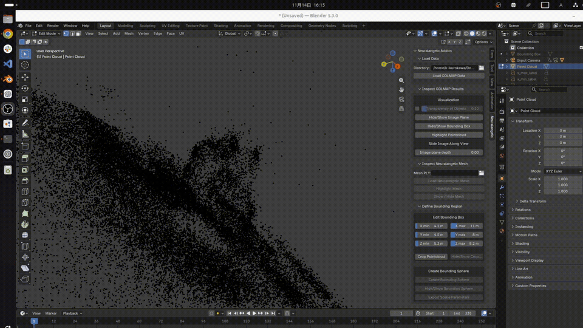
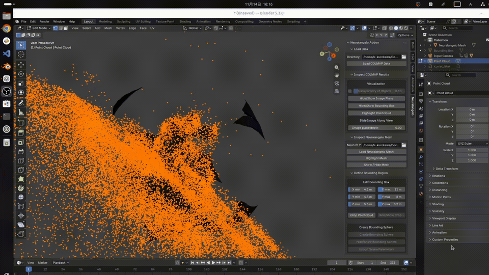

<div align="right"><a href="README.md">🇺🇸 English</a></div>


<div align="center">

# BlenderNeuralangelo

</div>


COLMAPデータを検査・前処理するための[Blender](https://www.blender.org/)アドオン
[Neuralangelo (CVPR 2023)](https://research.nvidia.com/labs/dir/neuralangelo/) 向け。
このアドオンを使用すると、COLMAPのポーズやスパースポイントを検査したり、再構築されたデータを重ね合わせたりすることができます。
Neuralangeloメッシュを作成し、トレーニング用のバウンディング領域をエクスポートします。

## はじめに

まず、コードをローカルディレクトリにクローンします。

```angular2html
cd /path/to/dir
git clone git@github.com:mli0603/BlenderNeuralangelo.git
```

### 0: COLMAPの実行

COLMAPの結果を取得するには、[手順](https://github.com/NVlabs/neuralangelo/blob/main/DATA_PROCESSING.md)に従ってください。あるいは、サンプル
は、[toy_example](toy_example) フォルダ内に用意されています。

COLMAP の指示に正しく従えば、次のようなフォルダ構造になるはずです：

```
DATA_PATH
├─ database.db      (COLMAP database)
├─ images           (undistorted input images)
├─ images_raw       (raw input images)
├─ sparse           (COLMAP data from SfM)
│  ├─ cameras.bin   (camera parameters)
│  ├─ images.bin    (images and camera poses)
│  ├─ points3D.bin  (sparse point clouds)
│  ├─ 0             (a directory containing individual SfM models. There could also be 1, 2... etc.)
│  ...
├─ stereo (COLMAP data for MVS, not used here)
...
```

### 1.1: コマンドラインからBlenderを実行する
以下の方法を使えば、インストールを気にすることなくBlenderを直接実行できます：

```bash
./blender --python PATH_TO_BlenderNeuralangelo/start_blender_with_addon.py
```

`PATH_TO_BlenderNeuralangelo` を、お使いの `BlenderNeuralangelo` へのパスに置き換えてください。

### 1.2: アドオンとしてインストールする

Blenderのアドオンとしてインストールすれば、Blenderを終了した後の再インストールが不要になります。アドオンとしてインストールするには：


### 1.3: コードとして実行

あるいは、次のようにコードを直接実行することもできます：


Blenderを終了した後、この手順を繰り返す必要があります。

### 2：コントロールパネルの場所を確認する

インストール後、BlenderNeuralangeloパネルは画面の右側に表示されます。また、キーボードの `N` キーを押しても表示できます。


### 3: COLMAPデータの読み込み

COLMAPは、COLMAPの作業ディレクトリへのパスを指定することで読み込むことができます。画像、カメラパラメータ、およびスパース
再構築の結果が読み込まれました。この時点ではNeuralangeloの出力ディレクトリがロックされているため、出力フォルダを指定する前に、「ダウンロード」などの場所にコピーしてください。


### 4: COLMAPデータの確認

COLMAPのデータは、RGB画像、スパース再構成、および姿勢推定の結果を確認することで、定性的に検証することができます。


### 5：関心領域の定義

Neuralangelo の関心領域をバウンディングボックスの形で定義するためのグラフィカルインターフェースが用意されています。点
関心領域の外側にある部分はトリミングできます。


### 6: 包絡球の定義

[Neuralangelo](https://research.nvidia.com/labs/dir/neuralangelo/) およびそれ以前の
作品 <sup>[1](https://arxiv.org/abs/2003.09852)[2](https://arxiv.org/abs/2106.10689)[3](https://arxiv.org/abs/2106.12052)</sup>
ニューラル表面再構成では、多くの場合、球形の関心領域が想定されます。このアドオンは、バウンディングスフィアを生成します。
そして、以下の手順に従ってシーンパラメータ（イントリニクス、ポーズ、バウンディングスフィア）をエクスポートします。
[Instant NGP](https://github.com/NVlabs/instant-ngp) 形式。
`transform.json` が変更されるため、元のディレクトリにあるファイルと置き換えてください。


### 7: Neuralangeloメッシュをオーバーレイする

COLMAPデータを読み込んだ後、Neuralangeloの`.ply`ファイルを選択してください。
**Mesh PLY**内の[`extract_mesh.py`](https://github.com/NVlabs/neuralangelo#extracting-mesh)をクリックし、
**Neuralangeloメッシュを読み込む**。このメッシュは、COLMAP座標系の点の上に重ねて表示されます。



**「メッシュのハイライト」**および**「ポイントクラウドのハイライト」**を使用して、ハイライト表示を切り替えます。
頂点、または**メッシュの表示／非表示**でメッシュの表示／非表示を切り替えます。



---
*This file was automatically generated by machine translation from [README.md](README.md).*
