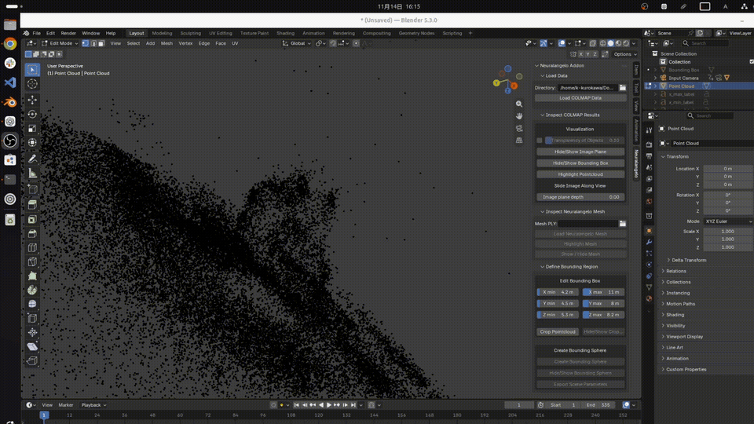
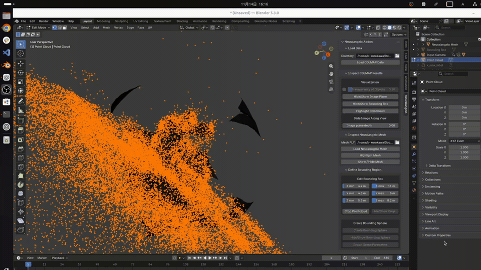

<!-- readme-translation:start -->
<div align="right"><a href="README.ja.md">🇯🇵 日本語</a></div>
<!-- ↑ このブロックは readme-translation アクションが自動生成しています。削除しないでください。 -->
<!-- readme-translation:end -->


<div align="center">

# BlenderNeuralangelo

</div>


[Blender](https://www.blender.org/) addon to inspect and preprocess COLMAP data
for [Neuralangelo (CVPR 2023)](https://research.nvidia.com/labs/dir/neuralangelo/).
The addon lets you inspect COLMAP poses and sparse points, overlay a reconstructed
Neuralangelo mesh, and export bounding regions for training.

> [!CAUTION]
> This repository has been modified since it was forked from the [original repository](https://github.com/mli0603/BlenderNeuralangelo). Please keep this in mind when using it.

## Getting Started

First clone the code to a local directory.

```angular2html
cd /path/to/dir
git clone git@github.com:mli0603/BlenderNeuralangelo.git
```

### 0: Running COLMAP

Please follow the [instructions](https://github.com/NVlabs/neuralangelo/blob/main/DATA_PROCESSING.md) to obtain COLMAP results. Alternatively, an example
is provided in the folder [toy_example](toy_example).

If COLMAP instructions are followed correctly, a folder structure of the following should be expected:

```
DATA_PATH
├─ database.db      (COLMAP database)
├─ images           (undistorted input images)
├─ images_raw       (raw input images)
├─ sparse           (COLMAP data from SfM)
│  ├─ cameras.bin   (camera parameters)
│  ├─ images.bin    (images and camera poses)
│  ├─ points3D.bin  (sparse point clouds)
│  ├─ 0             (a directory containing individual SfM models. There could also be 1, 2... etc.)
│  ...
├─ stereo (COLMAP data for MVS, not used here)
...
```

### 1.1: Run Blender from command line
You can directly run Blender without worrying installation by:

```bash
./blender --python PATH_TO_BlenderNeuralangelo/start_blender_with_addon.py
```

Replace `PATH_TO_BlenderNeuralangelo` with your path to `BlenderNeuralangelo`.

### 1.2: Install as Addon

Installing as a Blender Addon avoids re-installation after quitting blender. To install as an Addon:


### 1.3: Run as code

Alternatively, the code can be directly run as follows:


After quitting Blender, this step must repeat.

### 2: Locating the control panel

After installation, the BlenderNeuralangelo panel can be located on the right side or press `N` on the keyboard.


### 3: Load COLMAP data

COLMAP can be loaded by providing the path to the COLMAP work directory. The images, camera parameters and sparse
reconstruction results are loaded. Since the output directory from Neuralangelo is locked at this point, please copy the output folder to a location like Downloads before specifying it.


### 4: Inspect COLMAP data

COLMAP data can be inspected qualitatively by looking at the RGB, sparse reconstruction and pose results.


### 5: Defining region of interest

A graphics interface is provided to define the region of interest for Neuralangelo as a form of bounding box. Points
outside the region of interest can be cropped.


### 6: Defining bounding sphere

[Neuralangelo](https://research.nvidia.com/labs/dir/neuralangelo/) and prior
works <sup>[1](https://arxiv.org/abs/2003.09852)[2](https://arxiv.org/abs/2106.10689)[3](https://arxiv.org/abs/2106.12052)</sup>
on neural surface reconstruction often assumes a spherical region of interest. This addon generates a bounding sphere
and exports the scene parameters (intrinsics, poses, bounding sphere) following
the [Instant NGP](https://github.com/NVlabs/instant-ngp) format.
Since `transform.json` will be changed, please replace it with the one in the original directory.


### 7: Overlay a Neuralangelo mesh

After loading COLMAP data, select a `.ply` from Neuralangelo's
[`extract_mesh.py`](https://github.com/NVlabs/neuralangelo#extracting-mesh) in **Mesh PLY** and click
**Load Neuralangelo Mesh**. The mesh overlays the points in COLMAP coordinates.



Use **Highlight Mesh** and **Highlight Pointcloud** to switch the highlighted
vertices, or **Show / Hide Mesh** to toggle the mesh.


